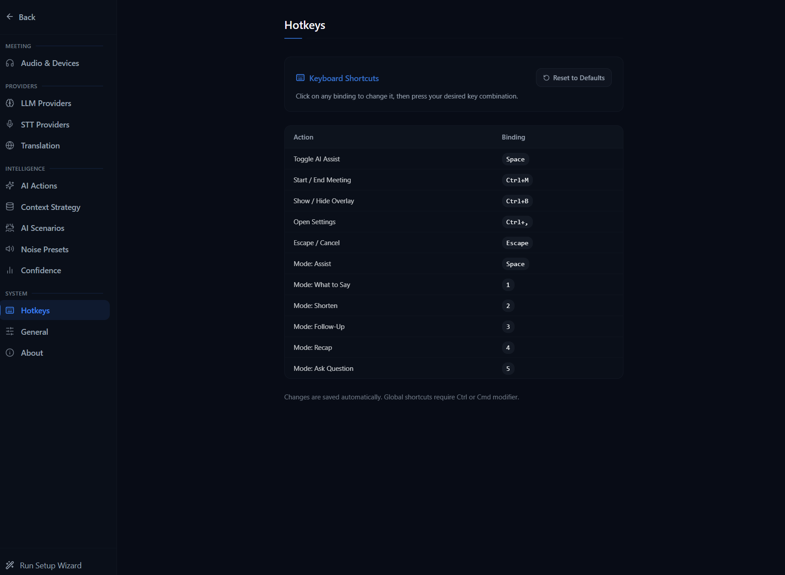

# Keyboard Shortcuts

NexQ has two levels of keyboard shortcuts: **global shortcuts** that work even when the app is not focused, and **meeting shortcuts** that work during an active meeting when the NexQ window is focused.

## Hotkey Configuration

You can customize all keyboard shortcuts in Settings > Hotkeys. The panel above shows the hotkey configuration interface where you can remap global and meeting shortcuts to your preferred key combinations.

## Global Shortcuts

These shortcuts are registered system-wide and work regardless of which application has focus.

| Shortcut | Action | Description |
|----------|--------|-------------|
| `Ctrl+M` | Start / End Meeting | Starts a new meeting if none is active; ends the current meeting if one is running |
| `Ctrl+B` | Toggle Overlay | Switches between the launcher (dashboard) and the overlay (meeting) window. Only works when a meeting is active |
| `Ctrl+,` | Open / Close Settings | Toggles the settings panel |
| `Ctrl+E` | Оценить мой ответ | Evaluates the latest finished «Вы» block, or checked own-answer blocks sequentially. Uses the current recording topic/transcript through an independent client; main chat runs concurrently. Does not focus a window. |
| `Ctrl+K` | Краткий ответ вкл. / выкл. | Registered only during a live session, works from other apps. Toggles between brief and standard length for subsequent requests, shows the result inside NexQ and preserves the running response. Outside a session it is released. |
| `Ctrl+Shift+Q` | Ответить на последний блок | Works from another app, routes to the live session without focusing NexQ. |
| `Ctrl+Shift+A` | Снимок экрана → ответ | Works from another app. Captures the monitor containing the session window and sends the image only on this explicit shortcut. |
| `Ctrl+Shift+B` | Показать / скрыть NexQ | Hides both main windows or restores the session. Never ends the recording. |
| `Ctrl+Shift+H` | Режим приватности | Excludes NexQ windows from supported captures while keeping them visible locally. |

The three background actions can be rebound in Settings → Hotkeys. The privacy toggle can be rebound in General settings. Conflicts are rejected; plain Ctrl+A remains local to NexQ. All global registrations have one launcher owner and ignore held-key repeat. If Windows refuses a binding, NexQ reports it inside its own interface.

In presentation privacy mode the taskbar entries and tray icon are hidden. Use the background show/hide shortcut to return to NexQ. Protected windows remain visible during a screenshot; when protection is off or not confirmed, NexQ temporarily hides its windows and restores them without stealing focus from the calling app.

## Meeting Shortcuts

These shortcuts work when a meeting is active and the NexQ window (launcher or overlay) is focused. They do not trigger when typing in input fields, text areas, or dropdowns. In text fields, Ctrl+A keeps its normal Select All behavior.

| Shortcut | Action | AI Mode |
|----------|--------|---------|
| `Space` | Generate AI Assist | Assist -- analyzes conversation and provides contextual help |
| `Ctrl+S` | Объединить выбранные фрагменты | Check fragments in the live transcript, then send only those fragments as one request in transcript order. Keeps every question in the combined text and replaces a running response. Clears the submitted selection immediately. |
| `Ctrl+D` | Снять выбор | Clears all checked transcript fragments without sending a request. |
| `Ctrl+A` | Снимок экрана → ответ | Outside text fields during a live session, captures the monitor containing the focused NexQ window, temporarily hiding visible NexQ windows. Sends the image to the current vision-capable model and shows the answer in chat. Image bytes stay out of local logs and history. |
| `1` | What to Say | Suggests what you should say next based on the conversation |
| `2` | Shorten | Condenses the recent discussion into a brief summary |
| `3` | Follow-Up | Generates follow-up questions or discussion points |
| `4` | Recap | Provides a recap of the conversation so far |
| `5` | Ask Question | Opens the free-form question input for custom AI queries |

> **Note:** The number keys (`1`--`5`) work with both the main keyboard and the numpad. They only trigger when no modifier keys (Ctrl, Alt, Meta) are held.

## System Tray

NexQ lives in the Windows system tray. Interaction patterns:

| Action | Result |
|--------|--------|
| Double-click tray icon | Show / toggle the main window |
| Middle-click tray icon | Toggle microphone mute |
| Right-click tray icon | Open the context menu (start/stop meeting, settings, quick copy, recent meetings, quit) |

## Tips

- **Overlay during meetings**: Use `Ctrl+B` to bring up the always-on-top overlay while your meeting app (Zoom, Teams, etc.) is in the foreground. The overlay is transparent and stays above other windows.
- **Quick AI assist**: During a meeting, press `Space` at any time to get an instant AI analysis of the current conversation. No need to switch windows.
- **Mute sources independently**: You can mute "You" (mic) or "Them" (system audio) STT independently from the overlay controls. This pauses transcription for that source without stopping audio capture or recording.
